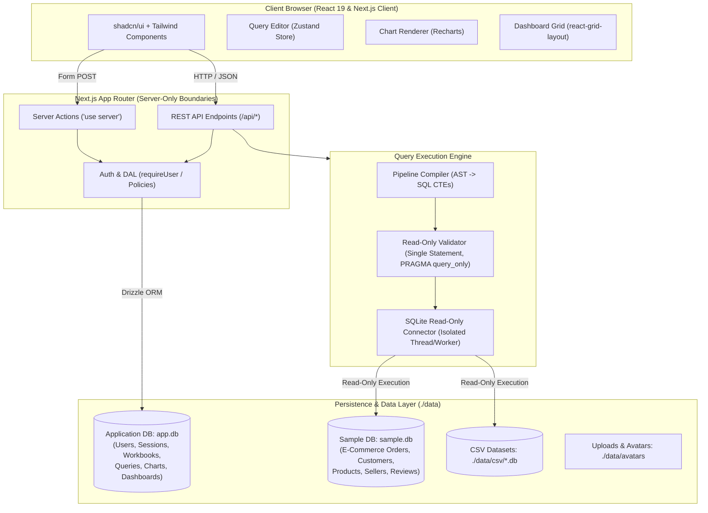

# Setup & Developer Guide

Comprehensive setup, architectural documentation, operational reference, and troubleshooting guide for **BI Kit**.

---

## 1. Overview

**BI Kit** is a local-first, modern Business Intelligence (BI) and data visualization application built in the style of **Frappe Insights**. It allows analysts and teams to:
- Connect SQLite databases or upload CSV files as analytical **Data Sources**.
- Author data pipelines using either an interactive **Visual Query Builder** (with step-by-step operations like Join, Filter, Mutate, Summarize, Order, Limit) or direct **SQL Mode** against read-only SQLite connections.
- Visualize aggregated results into customizable **Charts** (Bar, Line, Area, Pie, KPI Number Card, Data Table).
- Assemble charts into responsive, interactive **Dashboards** equipped with global filters (Date Range, Dynamic Categorical Select).
- Organize analytics inside **Workbooks**, with full multi-user authentication, session tracking, and user profile management.

### Tech Stack
- **Framework**: Next.js 16 (App Router with Partial Prerendering & React 19)
- **Language**: TypeScript 5 (Strict mode)
- **UI & Components**: [shadcn/ui](https://ui.shadcn.com/) primitives styled with Tailwind CSS v4 and Base UI
- **Application Database**: SQLite managed via `better-sqlite3` and [Drizzle ORM](https://orm.drizzle.team/)
- **Charts & Data Display**: Recharts wrapped via shadcn charts, TanStack Table v9
- **Dashboard Grid**: `react-grid-layout`
- **Validation & State**: Zod schemas shared across API/client boundaries, Zustand for client interaction state

### System Architecture



---

## 2. Prerequisites

Before setting up the project, ensure your environment meets the minimum version requirements:

- **Node.js**: `v20.9.0` or higher (tested on Node `v20` and `v24`). An `.nvmrc` file set to `20` is included in the repository. If you use `nvm` or `fnm`:
  ```bash
  nvm use
  ```
- **pnpm**: Version `10` or `11` (configured via `"packageManager": "pnpm@11.20.0"` in `package.json`).
  > [!IMPORTANT]
  > Always use `pnpm` exclusively for managing dependencies and running scripts. Do not use `npm` or `yarn`. Never run commands that create `package-lock.json`.

---

## 3. Quick Start

Run the following commands in the root of the repository:

```bash
# 1. Install dependencies
pnpm install

# 2. Configure environment variables (defaults work out of the box for local development)
cp .env.example .env.local

# 3. Run database migrations and seed demo data
pnpm setup

# 4. Start the Next.js development server
pnpm dev
```

Open [http://localhost:3000](http://localhost:3000) in your browser. You will be redirected to `/login`.

---

## 4. Environment Variables

All settings have safe defaults for local development. Configure them in `.env.local` as needed:

| Variable Name | Purpose | Default | Required in Production |
| :--- | :--- | :--- | :--- |
| `DATA_DIR` | Root directory for databases, CSV caches, avatars, and file uploads | `data` | No |
| `APP_DB_PATH` | File path to the primary SQLite application database | `data/app.db` | No |
| `SEED_ADMIN_EMAIL` | Default email for seeded administrator account | `admin@example.com` | Optional (defaults apply) |
| `SEED_ADMIN_PASSWORD` | Password for seeded administrator account | `ChangeMe123!` | **Yes** (seed aborts if default in prod) |
| `SEED_DEMO_USER_EMAIL`| Default email for seeded regular member account | `member@example.com` | Optional (defaults apply) |
| `SEED_DEMO_USER_PASSWORD` | Password for seeded regular member account | `ChangeMe123!` | **Yes** (seed aborts if default in prod) |
| `NODE_ENV` | Application environment mode (`development`, `production`, `test`) | `development` | Set by deployment host |
| `PORT` | HTTP port on which the Next.js server listens | `3000` | No |

---

## 5. Demo Data

Running `pnpm setup` or `pnpm db:seed` provisions demo datasets and pre-configured analytical entities:

### 1. Synthetic E-Commerce Database (`data/sample.db`)
A realistic Indian e-commerce sample database populated with deterministically generated records:
- **`customers`** (2,000 rows): Customer IDs, names, cities, states, geographical regions (North, South, East, West, Central).
- **`sellers`** (60 rows): Seller records, locations, join dates.
- **`products`** (400 rows): Product catalog spanning electronics, fashion, home goods, pricing, cost of goods.
- **`orders`** (12,000 rows): Multi-year order transactions (2023–2025), order statuses (`delivered`, `shipped`, `processing`, `canceled`), payment types (`upi`, `credit_card`, `net_banking`, `cash_on_delivery`).
- **`order_items`** (~30,105 rows): Item-level breakdown of orders with product references, quantities, prices, freight.
- **`reviews`** (~6,056 rows): Customer review ratings (1–5 stars) linked to delivered orders.

### 2. Analytical Entities in Application DB (`data/app.db`)
- **Data Source**: **"Demo Store"** (SQLite connection referencing `data/sample.db`).
- **Workbook**: **"Order Analysis"** containing folders and 6 pre-built queries:
  - **Folders**:
    - Queries: **"Revenue"** (contains `Revenue by Month` and `Revenue by Category`)
    - Charts: **"Revenue"** (contains `Revenue by Month`, `Revenue Trend`, and `Revenue by Category`)
    - Dashboards: None (root level)
  - **Queries**:
    1. `Orders`: High-level order count (root).
    2. `Delivered Orders`: Filtered delivered orders joined with item lines and computed margin values (root).
    3. `Revenue by Month`: Monthly revenue aggregations (in "Revenue" folder).
    4. `Revenue by Category`: Category-wise revenue summarization (in "Revenue" folder).
    5. `Customers by Region`: Regional customer distribution (root).
    6. `Customer Count by Region`: Geographic customer counts (root).
- **Charts**:
  - `Total Orders` (Number Card KPI, root)
  - `Revenue by Month` (Bar Chart, in "Revenue" folder)
  - `Revenue Trend` (Line Chart, in "Revenue" folder)
  - `Revenue by Category` (Donut Chart, in "Revenue" folder)
  - `Customers by Region` (Row / Bar Chart, root)
- **Dashboard**: **"Sales Overview"** combining the above charts into a responsive 12-column grid layout with interactive filters.

---

## 6. Demo Accounts

| Role | Email | Password | Permissions & Visibility |
| :--- | :--- | :--- | :--- |
| **Admin** | `admin@example.com` | `ChangeMe123!` | Full system access. Can view, manage, and edit all workbooks, data sources, dashboards, queries, user accounts, and system settings. |
| **Member** | `member@example.com` | `ChangeMe123!` | Standard member access. Can create own workbooks, queries, data sources, and dashboards; view shared team resources. Cannot access admin user management or global settings. |

> [!CAUTION]
> **Security Notice**:
> The default credentials (`ChangeMe123!`) are strictly intended for local development and demonstration.
> - The seed scripts explicitly refuse to run in `NODE_ENV=production` if default passwords are detected.
> - For production deployments, specify custom passwords via `SEED_ADMIN_PASSWORD` and `SEED_DEMO_USER_PASSWORD`.
> - Immediately change your password after logging in via **Settings > Security**.

### Account Creation & Registration Policy
- **First Registered User**: If the database contains zero users (e.g. after a clean reset without seeds), the very first user who registers through `/register` automatically receives the `admin` role. All subsequent registrations receive the `member` role.
- **Disabling Public Registration**: To turn off public registration, update the `allowRegistration` setting in `app_settings` to `false` or toggle it in **Settings > General**.

---

## 7. Database Workflow

BI Kit uses SQLite with Drizzle ORM. Database files live in the `./data` directory:
- `data/app.db`: Application state (users, sessions, settings, workbooks, queries, charts, dashboards).
- `data/sample.db`: Analytical sample store for demonstration queries.
- `data/csv/*.db`: SQLite tables generated from imported CSV uploads.

### Migration Lifecycle
1. **Schema Modifications**: Edit table definitions in `src/lib/db/schema.ts`.
2. **Generate Migration**: Run Drizzle Kit to create a new SQL migration in `src/lib/db/migrations/`:
   ```bash
   pnpm db:generate
   ```
3. **Review Migration**: Inspect the generated SQL file in `src/lib/db/migrations/*.sql`.
4. **Apply Migration**: Run the migration runner:
   ```bash
   pnpm db:migrate
   ```

### Database Scripts Reference

| Command | Description |
| :--- | :--- |
| `pnpm db:migrate` | Applies all pending migrations from `src/lib/db/migrations` to `data/app.db`. |
| `pnpm db:generate` | Inspects `schema.ts` and creates new migration SQL files. |
| `pnpm db:seed` | Runs the full seed suite: users, sample e-commerce database, and sample workbook. |
| `pnpm db:seed:users` | Seeds default admin and member accounts along with app settings. |
| `pnpm db:seed:demo` | Seeds or regenerates `data/sample.db` with 12,000 orders. |
| `pnpm db:seed:workbook`| Seeds the "Order Analysis" workbook and "Sales Overview" dashboard. |
| `pnpm db:reset` | Fully wipes databases and local artifacts, runs migrations, and reseeds everything. |
| `pnpm db:studio` | Launches Drizzle Studio in the browser to browse and inspect database tables. |
| `pnpm db:clean-tests` | Removes temporary test workbooks and demo artifacts from `app.db`. |

### Database Reset & Lock Protection
To reset the database cleanly:
```bash
# 1. Stop your development server (Ctrl + C)
# 2. Run reset:
pnpm db:reset
```
> [!WARNING]
> `pnpm db:reset` detects if the Next.js dev server is currently running on port 3000 and refuses to reset while SQLite file locks may be held. Always terminate the dev server before resetting, or pass `--force` if executing in automated pipelines.

### Backing Up the Database
Because SQLite runs in Write-Ahead Logging (WAL) mode:
1. Stop the application server (`pnpm dev` or production process).
2. Copy `data/app.db` along with `data/app.db-wal` and `data/app.db-shm` (if present) to your backup storage:
   ```bash
   cp data/app.db* /path/to/backups/
   ```

---

## 8. Using the App: End-to-End Walkthrough

1. **Log In**: Navigate to `/login` and sign in with `admin@example.com` / `ChangeMe123!`.
2. **Explore Data Sources**:
   - Go to `/data-sources`.
   - Click **Add Data Source** to connect an existing SQLite database file or upload a `.csv` dataset.
   - Click any data source name to open the **Schema Drawer**, displaying all tables, columns, data types, and primary/foreign keys.
3. **Build an Analytical Query**:
   - Navigate to `/workbooks` and click into the seeded **"Order Analysis"** workbook.
   - Click **New Query** to launch the Query Builder.
   - Choose a Data Source and Source Table.
   - Add operations:
     - **Join**: Combine tables on common keys (e.g., `orders.order_id` = `order_items.order_id`).
     - **Filter**: Filter records using conditions (e.g., `order_status = 'delivered'`).
     - **Mutate**: Compute new columns (e.g., `price * quantity`).
     - **Summarize**: Group by columns or date grains (day, week, month, year) with aggregations (`sum`, `count`, `avg`, `min`, `max`).
     - **Order By** and **Limit**: Sort and paginate results.
   - Alternatively, toggle to **SQL Mode** to type raw `SELECT` statements with syntax validation.
   - Click **Run** (`⌘ + Enter` / `Ctrl + Enter`) to view real-time results in TanStack Table.
4. **Create a Chart**:
   - Click **Create Chart** from the query results view.
   - Choose chart type: Bar, Line, Area, Pie, KPI Number Card, or Data Table.
   - Select X-Axis (category/time) and Y-Axis (metrics), customize palette, legend, and titles.
   - Save the chart.
5. **Assemble a Dashboard**:
   - Within the workbook, click **New Dashboard** or open the seeded **"Sales Overview"**.
   - Click **Add Chart** to insert saved charts into the canvas.
   - Drag and resize tiles via `react-grid-layout` handles.
   - Click **Add Filter** to place Date Range or Category filters that sync across all charts on the dashboard.
   - Save the dashboard. Toggle between **Edit Mode** and **View Mode**.
6. **Manage Settings**:
   - Visit `/settings/profile` to update your name, email, or avatar.
   - Visit `/settings/security` to change passwords and review active login sessions.
   - Visit `/settings/appearance` to select Light, Dark, or System theme.

---

## 9. Scripts Reference

All project commands defined in `package.json`:

```bash
pnpm dev                  # Starts development server with Webpack on http://localhost:3000
pnpm build                # Compiles optimized production bundle with TypeScript and route checking
pnpm start                # Starts production server from .next build output
pnpm lint                 # Runs ESLint (must pass with 0 errors and 0 warnings)
pnpm test                 # Executes all Vitest test suites once and cleanly terminates
pnpm test:watch           # Runs Vitest in interactive file-watching mode
pnpm db:generate          # Generates SQL migration scripts via drizzle-kit
pnpm db:migrate           # Applies pending migrations to SQLite database
pnpm db:seed              # Runs user, demo-data, and sample workbook seed scripts
pnpm db:seed:users        # Seeds admin and member user accounts
pnpm db:seed:demo         # Generates sample.db e-commerce database (12,000 orders)
pnpm db:seed:workbook     # Seeds Order Analysis workbook and Sales Overview dashboard
pnpm db:reset             # Completely wipes and reseeds local databases (with dev server safety guard)
pnpm db:studio            # Opens Drizzle Studio GUI on localhost:4983
pnpm db:clean-tests       # Cleans test artifacts from database
pnpm user:reset-password  # CLI script to reset a user's password and revoke active sessions
pnpm setup                # Installs packages, runs migrations, and seeds demo data in one step
```

---

## 10. Testing Guidelines

### Running Tests
Run the entire automated test suite with:
```bash
pnpm test
```

### Test Isolation Guard
Tests in BI Kit execute against isolated temporary SQLite databases created inside `os.tmpdir()`.
- **Zero Impact on Development Data**: Tests never read or modify `data/app.db`, `data/sample.db`, or any files in `./data`.
- **Hard Security Guard**: The test harness invokes `assertTestIsolationGuard()` from `src/lib/db/guard.ts`. If any test attempts to connect to or alter files in `./data`, the execution immediately throws a fatal exception.

---

## 11. Troubleshooting

### 1. pnpm blocked build scripts for `better-sqlite3`
**Symptom**: During `pnpm install`, pnpm warns that build scripts for `better-sqlite3` are ignored or blocked.
**Resolution**:
```bash
pnpm approve-builds
pnpm rebuild better-sqlite3
```

### 2. Unstyled pages or missing Tailwind CSS classes
**Symptom**: Pages render with unstyled raw HTML elements.
**Resolution**:
- Delete the Next.js cache directory: `rm -rf .next`
- Verify that `postcss.config.mjs` contains `@tailwindcss/postcss`.
- Verify that `src/app/globals.css` imports `@import "tailwindcss";` and `@import "tw-animate-css";`.
- Rebuild: `pnpm build && pnpm dev`.

### 3. "Database is locked" (`SQLITE_BUSY`) or stale rows after reset
**Symptom**: Operations fail with `SQLITE_BUSY` or deleted rows reappear.
**Cause**: The Next.js dev server or another Node process is holding open SQLite WAL file handles.
**Resolution**:
1. Terminate running `next dev` processes (`Ctrl + C` or `killall node`).
2. Remove orphaned WAL/SHM temporary files:
   ```bash
   rm -f data/*.db-wal data/*.db-shm
   ```
3. Run `pnpm db:reset`.

### 4. Port 3000 in use
**Symptom**: `next dev` errors with `Port 3000 is in use`.
**Resolution**:
Find and terminate the process listening on port 3000:
```bash
lsof -ti :3000 | xargs kill -9
```
Or start on another port:
```bash
PORT=3001 pnpm dev
```

### 5. Forgot Password / CLI Password Reset
**Symptom**: Locked out of your administrator or member account.
**Resolution**:
Use the built-in CLI reset utility:
```bash
# Direct command with email and password:
pnpm user:reset-password admin@example.com 'NewSecurePass123!'

# Or run interactively (prompts for email and masked password):
pnpm user:reset-password
```
This utility updates the password hash and revokes all active sessions for that account immediately.

### 6. Common Next.js 16 Quirks in this Project
- **Base UI Menu Group Requirement**: Base UI dropdown labels (`DropdownMenuLabel`) require enclosing `DropdownMenuGroup` context when using certain attributes; avoid bare labels outside menus.
- **Server Action Boundaries ("use server")**: Files declaring `'use server'` must **only export asynchronous functions**. Constants, types, and helper schemas must be defined in separate utility modules (e.g. `src/lib/schemas/`).
- **Server-Only Protection**: Modules that connect to the database (`better-sqlite3`, `drizzle-orm`), manage cookies (`next/headers`), or perform cryptography (`node:crypto`) import `'server-only'` to prevent accidental inclusion in client bundles. Standalone scripts execute with `tsx --conditions=react-server`.

---

## 12. Project Structure

```
bi-kit/
├── .env.example               # Template environment configuration
├── .nvmrc                     # Node.js version declaration (20)
├── knip.json                  # Knip dead-code scanner configuration
├── next.config.ts             # Next.js configuration (Webpack, Cache Components, PPR)
├── package.json               # Package manifests, dependencies, scripts, engines
├── postcss.config.mjs         # PostCSS configuration with @tailwindcss/postcss
├── tsconfig.json              # TypeScript strict configuration and path aliases
├── vitest.config.ts           # Vitest unit & integration test configuration
├── data/                      # Local persistence directory (.gitignore'd except structure)
│   ├── app.db                 # SQLite application database
│   ├── sample.db              # E-commerce analytical demo database
│   ├── csv/                   # Converted SQLite stores for uploaded CSVs
│   ├── avatars/               # User profile picture upload storage
│   └── uploads/               # Temporary file upload staging directory
├── docs/                      # Architectural documentation and setup guides
│   ├── SPEC.md                # Product requirements & Frappe Insights parity spec
│   ├── SETUP.md               # Detailed setup & developer operational guide
│   └── cleanup-report.md      # Knip dead-code audit and hygiene report
├── scripts/                   # CLI maintenance & seeding utilities
│   ├── reset-password.ts      # Password reset and session revocation CLI
│   └── seed/                  # Seed scripts (users, sample database, workbook)
└── src/                       # Application source code
    ├── proxy.ts               # Request routing / path proxying
    ├── app/                   # Next.js App Router (pages and API route handlers)
    │   ├── (app)/             # Authenticated workspace pages (dashboards, workbooks, data-sources)
    │   ├── (auth)/            # Authentication flows (login, register)
    │   └── api/               # REST API endpoints (/api/queries, /api/charts, /api/workbooks)
    ├── components/            # React UI components (shadcn/ui composition)
    │   ├── auth/              # User menu, session providers, auth contexts
    │   ├── charts/            # Chart renderer, configuration drawer, export dialogs
    │   ├── dashboards/        # Grid editor, tile containers, global filters
    │   ├── datasource/        # Schema browser sheet, connector modals
    │   ├── layout/            # Sidebar, breadcrumbs store, header, theme toggle
    │   ├── query-builder/     # Visual operation cards, SQL view, results table
    │   ├── settings/          # Profile form, appearance form, security & session list
    │   └── ui/                # shadcn/ui primitive library (buttons, tables, popovers)
    └── lib/                   # Server domain logic, query compilation, database
        ├── auth/              # Password hashing, sessions, policies, DAL, actions
        ├── charts/            # Chart CRUD service, series aggregations
        ├── connectors/        # Pluggable connector framework (Postgres, MySQL, MSSQL, Mongo, SQLite, CSV, Excel)
        ├── dashboards/        # Dashboard CRUD, layout serialization, filter injections
        ├── data-sources/      # Data source registration, CSV parsing & inference
        ├── db/                # Drizzle schema, SQLite connection singleton, migrations
        ├── queries/           # Saved query persistence & execution services
        ├── query-engine/      # CTE AST compiler, query validation, column inference
        ├── schemas/           # Shared Zod schemas for input validation
        └── utils.ts           # Shared utilities (date formatting, CSV building, slugify)
```

---

## 13. Roadmap

Future capabilities planned beyond the current MVP:
- **Role-Based Access Control (RBAC) & Sharing**: Fine-grained permissions (Viewer, Editor, Owner) for workbooks and dashboards with public read-only shareable links.
- **Scheduled Automated Refreshes**: Background cron-based query execution with cached materialized results and threshold alerting.
- **Export to PDF & Multi-page Reports**: Headless browser export of complete dashboards into presentation-ready PDF reports.
- **External SQL Connectors**: Native read-only connectors for PostgreSQL, MySQL, ClickHouse, and Snowflake with connection pooling and SSL tunnel support.

